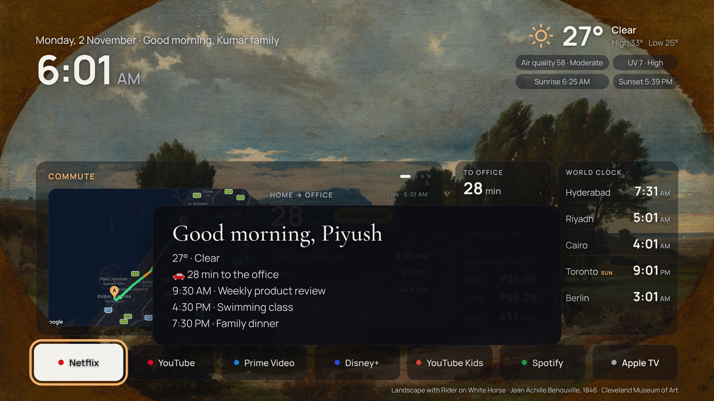
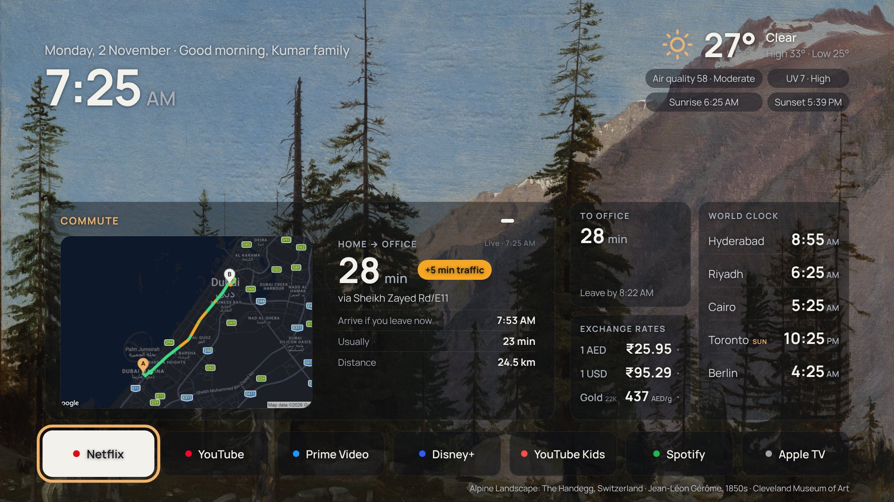
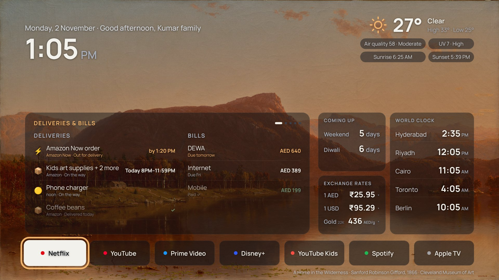
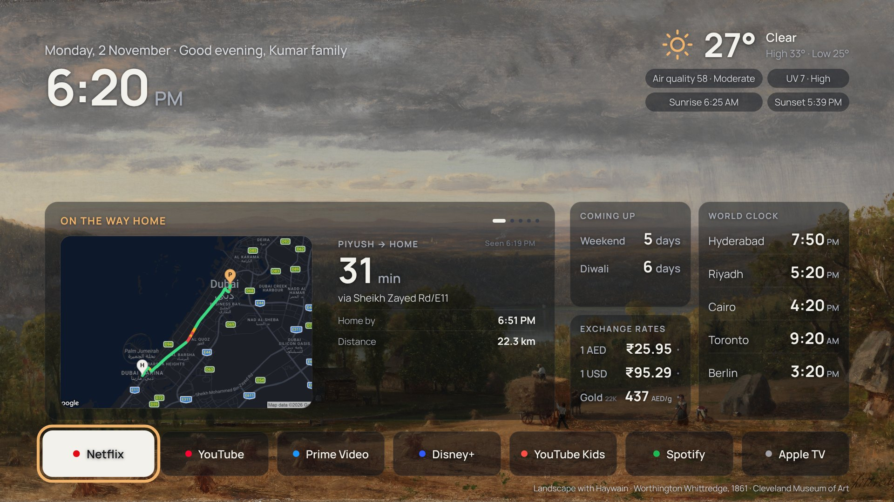
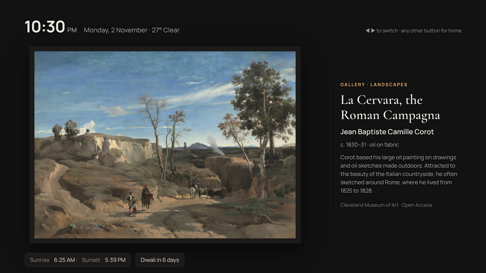

# Home TV

Turn a Samsung TV that sits dark most of the week into a calm family dashboard and a living art gallery, run by a spare Windows laptop. No coding needed to set it up.

## What it does

- **Switches itself on** at times you choose, says a short good morning or good evening, and plays music (devotional music early in the morning if you like, instrumental jazz otherwise).
- **Shows your day**: clock, weather, air quality, calendar, world clocks, exchange rates and the 22K gold price, headlines and a kids' board.
- **Live commute** with a traffic map, when to leave and how today compares with a normal day (optional, free Google Maps key).
- **Gallery mode** at night or when nobody's using it: paintings from public museum collections, with film posters mixed in if you add a free TMDB key.
- **Looks after itself**: restarts anything that stops and keeps the laptop awake.

| | |
|---|---|
|  |  |
|  |  |

## What you need

- A Samsung smart TV from 2017 or later (Tizen).
- A Windows 10 or 11 laptop or PC that can stay plugged in at home, on the same Wi-Fi as the TV.
- About 45 minutes.

## Setup

1. Download the latest zip from the [Releases](../../releases) page (or **Code → Download ZIP**) and unzip it.
2. Open **START-HERE.html** and follow the steps. In short: install Docker Desktop, switch on "Power On with Mobile" on the TV, then double-click **Setup.cmd** and answer a few questions.

Everything you enter (city, calendar links, keys) stays in `C:\HomeTV` on your own laptop.

## Optional extras

The `extras` folder has three add-ons that need a bit more comfort with the command line: an "on the way home" map using Find My, deliveries and bills read from Gmail, and a family photo frame from a folder of your photos. See [extras/README.md](extras/README.md).

## How it was built

The whole thing was built in an afternoon by describing it to Claude and giving feedback, without writing code by hand. If something doesn't work on your TV, open an issue with your TV model and what you see. I'll help where I can, but this is a hobby project with no guarantees.

## Credits

Artwork from the open-access collections of the Art Institute of Chicago and the Cleveland Museum of Art. Film posters from [TMDB](https://www.themoviedb.org); this product uses the TMDB API but is not endorsed or certified by TMDB. Weather from Open-Meteo. Voices from Microsoft Edge text-to-speech.

## License

MIT. See [LICENSE](LICENSE).
